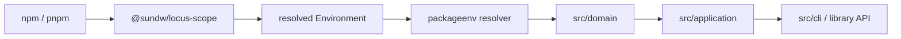

# locus-scope 目标实现架构

## 目录

只列实现与交付目录；`test/`、`documents/`、`.agents/` 与仓库根文件不在此列。

```text
src/
├── domain/
├── application/
├── package-environment.ts
├── packageenv.ts
├── cli/
├── index.ts
└── bin.ts

packaging/
└── npm/
    └── locus-scope/

scripts/
├── build.mjs
├── npm-publish.mjs
├── npm-release.mjs
├── verify-npm-release.mjs
├── registry.mjs
├── test.mjs
├── branch-sync.mjs
├── config/
└── lib/
```

## 依赖



- `src/domain` 是 Scope/Graph domain core，不依赖 npm、package.json、lock、cache、Node package-manager 或 Registry 类型。
- `src/application` 是 Scope 的稳定 application API；`src/cli` 是 Node CLI frontend。
- `src/packageenv.ts` 只把 resolved Environment 转为 domain Resolver，不重新实现 npm name、SemVer 或 package manager 规则。
- `src/package-environment.ts` 从实际 npm/pnpm 安装环境构造 importer-relative exact dependency graph，不解析 Locus definitions 的领域语义。
- `@sundw/locus-scope` 在同一 Node 进程中装配 Workspace，并调用共享 domain/application API。

## 目录规则

- `src/` 按稳定职责建立 domain、application、package environment 和 CLI package，不使用 `utils`、`common` 或按文件类型分组。
- `packaging/npm/locus-scope/` 是唯一主 npm Package，不再分发平台 host package。
- 根 `package.json` 的 package scripts 是仓库任务的唯一公共入口；跨平台实现位于 `scripts/*.mjs`。
- Package manager 与 Node runtime 不得复制 Scope、Entity、Relation、Import、ownership 或 Workspace 语义。
- 项目级 Verdaccio 与测试状态只写 `temp/`；Node package-manager cache/store 继续使用机器级全局配置。
- 根 `VERSION` 是主 npm Package 的发行版本真相。

## 运行与编译基线

- Node.js 24 LTS。
- TypeScript 5.9，`tsconfig.json` 使用 strict、NodeNext、声明文件和 source map。
- YAML 使用 `yaml`，外部结构使用 `zod`，mutation 使用 `write-file-atomic`。
- 产物写入 `temp/ts-build/` 和 `temp/release/`。
