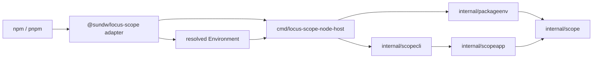

# locus-scope 目标实现架构

## 目录

```text
cmd/
└── locus-scope-node-host/

internal/
├── apperror/
├── buildinfo/
├── packageenv/
├── scope/
├── scopeapp/
└── scopecli/

packaging/
└── npm/
    ├── locus-scope/
    ├── locus-scope-win32-x64/
    ├── locus-scope-linux-x64/
    ├── locus-scope-linux-arm64/
    ├── locus-scope-darwin-x64/
    └── locus-scope-darwin-arm64/

scripts/
├── build.mjs
├── npm-publish.mjs
├── npm-release.mjs
├── verify-npm-release.mjs
├── registry.mjs
├── test.mjs
├── branch-sync.mjs
├── config/
└── lib/
```

## 依赖



- `internal/scope` 是 Scope/Graph domain core，不依赖 npm、package.json、lock、cache、Node 或 Registry 类型。
- `internal/scopeapp` 是 Scope 的稳定 application API；`internal/scopecli` 是 Cobra CLI frontend。
- `internal/packageenv` 只把 Node 提供的 resolved Environment 转为 `scope.Resolver`，不重新实现 npm name、SemVer 或 package manager 规则。
- `@sundw/locus-scope` 负责从实际 npm/pnpm 安装环境构造 importer-relative graph、选择 platform host 并转发进程 I/O；不解析 Locus definitions。
- 私有 Go host 通过单次 JSON request 接收 Environment，装配 Workspace，并调用共享 `scopeapp` 与 `scopecli`。

## 目录规则

- `internal/` 只按稳定职责建立 package，不使用 `utils`、`common`、`src` 或按文件类型分组。
- `packaging/npm/` 聚合主 Package 与五个平台 host Package；不存在第二套 standalone 交付。
- 根 `package.json` 的 package scripts 是仓库任务的唯一公共入口；跨平台实现位于 `scripts/*.mjs`。
- Package manager 与 Node delivery adapter 不得复制 Scope、Entity、Relation、Import、ownership 或 Workspace 语义。
- 项目级 Verdaccio 与测试状态只写 `temp/`；Node package-manager cache/store 继续使用机器级全局配置。
- 根 `VERSION` 是六个 npm Package 的发行版本真相。
