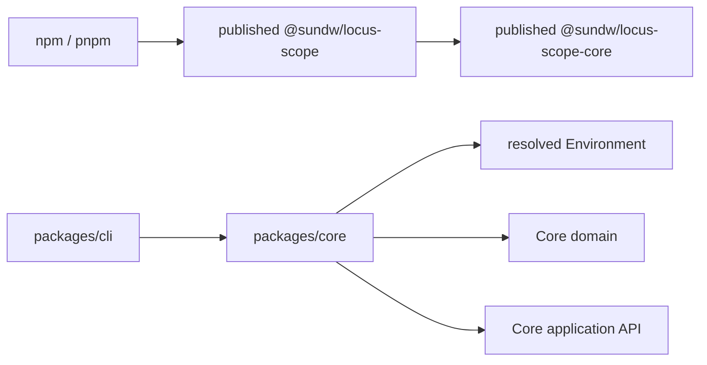

# locus-scope 目标实现架构

## 目录

只列实现与交付目录；`test/`、`documents/`、`.agents/` 与仓库根文件不在此列。

```text
packages/
├── core/
│   ├── tsconfig.json
│   └── src/
│       ├── domain/
│       ├── application/
│       ├── package-environment.ts
│       ├── packageenv.ts
│       └── index.ts
└── cli/
    ├── tsconfig.json
    └── src/
        ├── protocol.ts
        ├── index.ts
        └── bin.ts

packaging/
└── npm/
    ├── locus-scope-core/
    │   └── package.json
    └── locus-scope/
        ├── package.json
        └── bin/
            └── locus-scope.mjs

scripts/
├── build.mjs
├── typecheck.mjs
├── npm-publish.mjs
├── npm-release.mjs
├── verify-npm-release.mjs
├── registry.mjs
├── test.mjs
├── branch-sync.mjs
├── config/
└── lib/
```

`packages/core` 和 `packages/cli` 是源码与 TypeScript project boundary，不直接决定最终 npm package name。发布 package 的 name、exports、bin、files 和 dependencies 由 `packaging/npm/*/package.json` 定义。

## 依赖



- `packages/core/src/domain` 是 Scope、Workspace、引用解析、校验和 Graph Index 的领域核心。
- `packages/core/src/application` 是稳定的进程内 application API。
- `packages/core/src/packageenv.ts` 把 resolved Environment 转为 domain Resolver。
- `packages/core/src/package-environment.ts` 从实际 npm/pnpm 安装环境构造 importer-relative exact dependency graph，不解析 Locus definitions 的领域语义。
- `packages/cli` 只负责 CLI protocol、参数、输出、退出状态和进程入口；它不复制 Core 语义。
- `@sundw/locus-scope` 发布包包含 CLI 编译产物并依赖 `@sundw/locus-scope-core`。

## 目录规则

- 源码按 `core` 和 `cli` 两个职责边界组织，不按文件类型建立 `utils` 或 `common` 目录。
- `packaging/npm/locus-scope-core` 和 `packaging/npm/locus-scope` 是发布 metadata 的唯一真相。
- 测试、E2E fixture、构建产物和 release staging 不进入发布 package。
- 根 `package.json` 的 scripts 是仓库任务的公共入口；跨平台实现位于 `scripts/*.mjs`。
- Package manager 与 Node runtime 不得复制 Scope、Entity、Relation、Import、ownership 或 Workspace 语义。
- 项目级 Verdaccio 与测试状态只写 `temp/`；Node package-manager cache/store 继续使用机器级全局配置。
- 根 `VERSION` 是两个发布 package 的版本真相。

## 运行与编译基线

- Node.js 24 LTS。
- TypeScript 5.9，两个 package 使用 strict、NodeNext、声明文件和 source map。
- Core 使用 `yaml`、`zod` 和 `write-file-atomic`。
- CLI 依赖 Core，并使用 CLI 所需的 `zod` schema。
- 编译产物写入 `temp/build/{core,cli}/`；npm staging 和 tarball 写入 `temp/release/npm/`。
