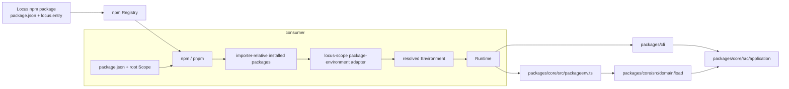

# Package设计

## 简述

Locus Scope 的 Scope 分发继续使用标准 npm-compatible package 作为唯一分发模型。一个可分发 Locus Scope package 对应一个 Scope；`package.json` 是名称、版本和依赖的唯一真相，`locus.entry` 指向包内唯一的 Scope manifest。`@sundw/locus-scope-core` 是不对应 Scope 的进程内 Core runtime package，不携带 `locus.entry`。npm 或 pnpm 负责 Package 解析、安装、lockfile 和缓存；Locus 只消费其 resolved Environment。

## 职责

本文定义 package metadata、Import 与 identity、Node adapter、resolved Environment 和 runtime。Entity、Scope、Export、Projection、Relation 和 Group 语义仍以[核心协议](protocol/PROTOCOL.md)为唯一权威来源；本地 Scope 发现、Workspace 装配和检查语义见[Scope 设计](Scope设计.md)。

## 架构与数据流

npm 与 pnpm 的物理布局不同，但必须产生同一种 resolved Environment；从 `packageenv` 开始，Workspace 装配和 CLI 行为完全共用。



## example：发布一个 npm-compatible Locus Package

`@example/app` 的 package root 同时包含标准 npm metadata 和唯一 Scope manifest：

```json
{
  "name": "@example/app",
  "version": "1.0.0",
  "files": ["index.js", "locus.yaml", "definitions"],
  "exports": {
    ".": "./index.js",
    "./package.json": "./package.json"
  },
  "dependencies": {
    "@example/base": "^1.0.0",
    "@example/helper": "^2.0.0"
  },
  "locus": {
    "entry": "locus.yaml"
  }
}
```

它的 Scope 只通过 bare npm name 使用直接依赖；普通 JavaScript dependency `@example/helper` 可以安装，但不会进入 Scope graph：

```yaml
id: example-app
imports:
  base: "@example/base"
```

使用 npm 或 pnpm 的原生命令检查并发布：

```text
npm pack --json --ignore-scripts
npm publish ./example-app-1.0.0.tgz --ignore-scripts
```

`pack` 生成标准 npm tarball；发布前检查 packed file list 和 SHA-512 integrity，发布后核对 Registry 中确切 `name@version` 的 `dist.integrity`。Agent 工作流见 `$use-locus-scope` 的[发布指南](../../.agents/skills/use-locus-scope/references/publish-package.md)。

## example：通过 npm 或 pnpm 使用同一个 Scope

Node consumer 让 package manager 负责解析、安装、cache 和原生 lockfile：

```text
npm install @sundw/locus-scope @example/app @example/modern
npx locus-scope validate --json
```

或：

```text
pnpm add @sundw/locus-scope @example/app @example/modern
pnpm exec locus-scope validate --json
```

`locus-scope` package-environment adapter 从 root importer 开始，在每个 importer 自己的解析上下文中发现 Locus dependency，再把一次性 resolved Environment 交给 Node runtime。npm hoist 与 pnpm symlink 可以产生不同物理目录，但相同 `npm:<name>@<version>`、entry 和 dependency edges 必须得到相同的 Scope、Entity 和 Relation JSON。

## 约束

下表是本设计的规范性边界；示例只用于说明，不放宽这些约束。

| 领域 | 约束 |
| --- | --- |
| 分发单元 | 一个可分发 Locus Package 必须同时是一个标准 npm package、一个分发单元和一个 Scope。Locus 不提供第二套 Package manager、Registry client、lock、cache 或 installation state。 |
| Metadata 真相 | `package.json.name`、`version` 和 `dependencies` 分别定义 Package 名称、版本和可解析依赖；这些 npm 语义只由 Node adapter 读取和验证。 |
| `locus` metadata | 有 `locus` 时只允许相对 package root 且不经 `..` 或 symlink 逃逸的 `locus.entry`；entry 必须指向 `locus.yaml`、`locus.yml` 或 `locus.json`。没有 `locus` 的普通 npm dependency 不进入 resolved Environment。 |
| JavaScript 兼容 | `main` 和 JavaScript `exports` 可以并存；存在 `exports` 时，Locus Package 必须精确导出 `"./package.json"`，使 importer-relative 解析不依赖物理安装布局。 |
| Import 声明 | Package Scope 的 Package Import 只声明依赖目标，即 bare npm package name；本地 root Scope 仍可使用本地 Import。Import 不声明版本、range、resolved identity 或安装位置。 |
| Import edge | 每个 bare Scope Import 必须是当前 importer 的 direct dependency，并且只按该 importer 的 resolved dependency edge 查找。Package Scope 不得从 root dependency 集合或全局 Package 集合回退查找同名 Package。 |
| Scope graph | npm dependency graph 决定可解析 Package universe；Scope graph 仍只由各 `locus.entry` 中的 Imports 选择。JavaScript 不解析 Locus definition，也不复制 Scope/Graph 语义。 |
| Package identity | npm 或 pnpm 负责版本解析与实际安装位置；adapter 将每条 edge 固化为 `npm:<name>@<exact-version>`。runtime 只消费 exact identity，不解析版本、range 或物理安装布局。 |
| 冲突 identity | 同一 identity 只能对应一组一致的 entry 和 resolved Locus dependency edges；物理多副本不一致时必须在执行 Scope 命令前失败。 |
| Node root | adapter 应用显式 `--scope` 或最近 ancestor manifest 规则；Scope root 有 `package.json` 时建立 root importer，没有时使用空 root dependencies。只有出现 bare Package Import 时才要求对应 direct dependency。 |
| Node 解析 | 每个 importer 在自己的 Node resolution context 中解析 direct dependencies；不得扫描或拼接 `node_modules`、pnpm store 等物理布局。 |
| Environment | adapter 递归生成 `rootScope`、`rootDependencies` 和以 exact identity 为 key 的 `packages`；每个 Package 只包含 canonical root、relative entry 与 resolved Locus dependency edges，maps 确定性排序。 |
| Resolver 边界 | packageenv resolver 只验证 identity 非空、target 存在、entry 位于 canonical root 内且为合法 Scope manifest，并把 Environment 转成 Scope Resolver；不得重新实现 npm name、SemVer、package.json 或 lockfile 规则。 |
| 共用执行核心 | CLI 和 library consumer 调用同一 Scope domain/application 实现；不得复制 Scope validation、query 或稳定 JSON view。 |

## 验收

| 场景 | 可观察结果 |
| --- | --- |
| Importer-relative 多版本 | 同一 consumer 可同时解析 `@example/base` 1.x 与 2.x；两个 `npm:` identity、dependency edges 和 ownership 均正确。 |
| 普通 npm dependency | dependency 由 npm/pnpm 安装，但不进入 resolved Environment 或 Scope graph。 |
| npm/pnpm 布局一致 | hoisted npm layout 与 pnpm symlink layout 产生相同的规范 Scope、Entity 和 Relation JSON。 |
| 安全失败 | 缺失直接依赖、blocked package.json export、entry escape 和冲突 identity 在执行 Scope 命令前失败。 |
| 交付边界 | 发布 `@sundw/locus-scope-core` Core package 和 `@sundw/locus-scope` CLI/library package；不存在平台 Package 或 standalone installer。 |

完整测试注册、fixture、隔离方式和完成命令见[测试设计](测试设计.md)。
