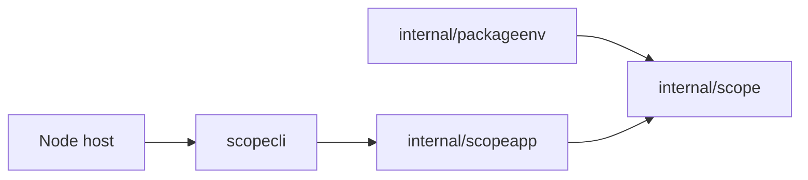

# 核心 API

## 简述

`internal/scopeapp` 是 transport-independent application API。CLI、Node host 和未来消费层不直接实现或复制领域语义。

## 职责

本文定义 Scope 的进程内 Go 契约及分层边界。CLI 参数、文本输出和退出状态由 [CLI](CLI.md) 定义；Entity、Scope 与 Relation 规则由[核心协议](PROTOCOL.md)定义；resolved Package environment 由 [Package 设计](../Package设计.md)定义。

## 分层



分层规则：

- `scopecli` 只负责参数、输出和退出状态。
- `scopeapp` 的 exported types 和 methods 是稳定 application API。
- `scope` 实现领域规则和用例所需能力。
- `packageenv` 是 resolved Package graph 到 Scope Resolver 的 adapter。
- CLI、host protocol 或未来 transport 类型不得进入 `scopeapp` 或领域包。

## Scope API

`scopeapp` 通过 execution context 使用一个已加载 Workspace，并可按同一宿主策略 load/reload：

```go
type Environment interface {
    Current() *scope.Workspace
    LoadPath(path string) (*scope.Workspace, error)
    Reload() (*scope.Workspace, error)
}
```

稳定 application surface 按领域能力组织：

| 能力 | 语义 |
| --- | --- |
| `Query(kind, selector)` | 对 Scope、Group、Entity、Relation 执行统一 list/show/find，返回稳定 envelope。 |
| `Graph(seeds, depth, via)` | 返回有向出边子图。 |
| `Path(from, to, via)` | 返回一条确定的最短有向路径。 |
| `Impact(seeds, via)` | 返回反向可达 Entity 与 Relation。 |
| `Mutate(request)` | clone/change/validate/atomic write/reload Entity 或 Relation。 |
| `Diff(left, right)` | 加载并归一化 selector 两侧语义子图后比较。 |
| `Validate()` | 返回已验证 Workspace summary。 |

宿主与 application 的边界如下：

- Workspace 来源由宿主提供的 resolved Environment 决定；本地-only Scope 可以使用空 Package graph。
- Node host 使用 npm/pnpm resolved Package graph。
- stdin、cwd 和路径加载能力由共享 runner context 注入。
- Scope application 不读取进程全局 stdin 或 cwd。
- Entity result 使用 `{key, ref?, object, source?}`。
- Relation result 使用 `{fromKey,toKey,object,source?}`。
- Core 和 application DTO 不暴露 graph implementation、CLI writer、exit code 或 host protocol 类型。


## 稳定性规则

- application result 使用稳定 DTO，不暴露 CLI writer、exit code 或 HTTP 状态。
- 新能力按领域行为增加明确 request/result；不按 CLI 命令机械创建 API。
- 查询语言使用独立 Query request/result；不使用命令字符串作为通用 API。
- application error 的分类、reason、上下文与传播规则以[错误契约](ERRORS.md)为准；CLI 的错误输出和退出状态以 [CLI](CLI.md#输出与退出状态) 为准。程序不得解析错误文本。

## 验证

- `scopeapp` 测试排序、ownership、reference resolution、graph、diff、mutation 和 DTO 契约。
- CLI 测试只覆盖参数、输出和退出状态，不重复 application/domain semantics。
- Node adapter、host 与 E2E 验证 resolved Environment 进入同一核心 API 后得到一致结果。
