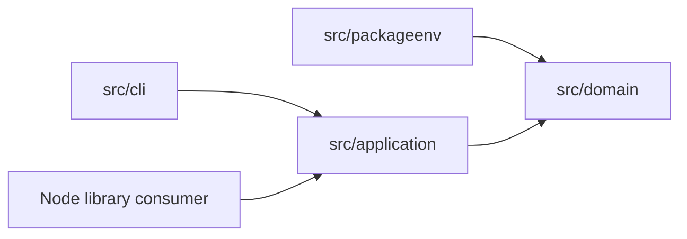

# 核心 API

## 简述

`src/application` 是 transport-independent application API。CLI、Node library consumer 和未来消费层不直接实现或复制领域语义。

## 职责

本文定义 Scope 的进程内 TypeScript application 契约及分层边界。CLI 参数、文本输出和退出状态由 [CLI](CLI.md) 定义；Entity、Scope 与 Relation 规则由[核心协议](PROTOCOL.md)定义；resolved Package environment 由 [Package 设计](../Package设计.md)定义。

## 分层



分层规则：

- `src/cli` 只负责参数、输出和退出状态。
- `src/application` 的 exported types 和 methods 是稳定 application API。
- `src/packageenv` 是 resolved Package graph 到 Scope Resolver 的 adapter。
- `src/domain` 实现领域规则和用例所需能力。
- CLI、package manager 或未来 transport 类型不得进入 application 或 domain。

## Scope API

`src/application` 通过 execution context 使用一个已加载 Workspace，并可按同一宿主策略 load/reload：

```ts
interface WorkspaceEnvironment {
  current(): Workspace;
  loadPath(path: string): Promise<Workspace>;
  reload(): Promise<Workspace>;
}
```

稳定 application surface 按领域能力组织：

| 能力                        | 语义                                                                           |
| --------------------------- | ------------------------------------------------------------------------------ |
| `Query(kind, selector)`     | 对 Scope、Group、Entity、Relation 执行统一 list/show/find，返回稳定 envelope。 |
| `Graph(seeds, depth?, via)` | 返回有向出边子图；省略 `depth` 时遍历全部正向可达节点。                        |
| `Path(from, to, via)`       | 返回一条确定的最短有向路径。                                                   |
| `Impact(seeds, via)`        | 返回反向可达 Entity 与 Relation。                                              |
| `Adjacent(request)`         | 查询指定 Entity 的入边、出边或双向邻接关系。                                   |
| `Mutate(request)`           | clone/change/validate/atomic write/reload Entity 或 Relation；add 的 Definition target 必须通过与 Workspace loader 相同的 document selection policy，只有 reload 后变更仍被发现并验证成功才返回成功。 |
| `Diff(left, right)`         | 加载并归一化 selector 两侧语义子图后比较。                                     |
| `Validate()`                | 返回已验证 Workspace summary。                                                 |

`Adjacent` 请求：

```ts
interface AdjacentRequest {
  entities: EntityKey[];
  direction: "incoming" | "outgoing" | "both";
  via?: Predicates;
}
```

`Adjacent` 返回现有 Entity/Relation DTO，包含输入节点、相邻节点及匹配 Relation。结果去重、稳定排序，并遵循现有 source/provenance 输出规则。空 `entities` 返回空结果；`via` 复用现有 Relation 筛选语义；`both` 对自环 Relation 只返回一次。

`Graph` 的显式 `depth: 0` 仍只返回 seeds。省略 `depth` 表示不设深度上限；遍历使用 visited 集合处理环，不要求图为 DAG。负数深度仍为参数错误。

宿主与 application 的边界如下：

- Workspace 来源由 runtime 提供的 resolved Environment 决定；本地-only Scope 可以使用空 Package graph。
- Node runtime 使用 npm/pnpm resolved Package graph。
- stdin、cwd 和路径加载能力由共享 runner context 注入。
- Scope application 不读取进程全局 stdin 或 cwd。
- Entity result 使用 `{key, ref?, object, source?}`。
- Relation result 使用 `{fromKey,toKey,object,source?}`。
- Core 和 application DTO 不暴露 graph implementation、CLI writer、exit code 或 host protocol 类型。

## 图索引与快照

Workspace 内部维护与 Workspace 快照绑定的双向邻接索引：

```ts
interface GraphIndex {
  outgoing: Map<string, number[]>;
  incoming: Map<string, number[]>;
}
```

- 索引键由完整 EntityKey 无歧义编码生成；索引值对应已解析 Relation 的位置。
- 索引按已验证 Relation 构建，不重新解析 DSL。
- `Graph`、`Path`、`Impact`、`Adjacent` 共用索引及 Relation 匹配逻辑。
- 索引不进入 Application DTO，也不对外暴露可变 Map。
- 查询保持现有确定性排序；不同 Relation Type 的平行边不能因端点相同而丢失。
- 加载完成后 Workspace 对外视为只读。Mutation 成功后重新加载并验证，发布新的 Workspace 和索引；失败时不发布部分修改的内存图。
- 旧 Workspace 可以继续用于读取，但不会自动反映后续修改。

## 稳定性规则

- application result 使用稳定 DTO，不暴露 CLI writer、exit code 或 HTTP 状态。
- 新能力按领域行为增加明确 request/result；不按 CLI 命令机械创建 API。
- 查询语言使用独立 Query request/result；不使用命令字符串作为通用 API。
- application error 的分类、reason、上下文与传播规则以[错误契约](ERRORS.md)为准；CLI 的错误输出和退出状态以 [CLI](CLI.md#输出与退出状态) 为准。程序不得解析错误文本。

## 验证

- `src/application` 测试排序、ownership、reference resolution、graph、diff、mutation 和 DTO 契约。
- CLI 测试只覆盖参数、输出和退出状态，不重复 application/domain semantics。
- Node adapter、library API 与 E2E 验证 resolved Environment 进入同一核心 API 后得到一致结果。
- application 测试覆盖无深度限制的 Graph 及 Adjacent 的 direction/filtering，不在 CLI 重复领域语义。
